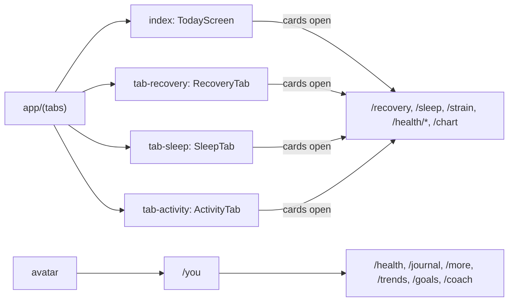

# The glow design (ported from unstrap)

The tab roots and the type of this fork follow the design system of [unstrap](https://github.com/sayed0am/unstrap)
(formerly OpenStrap), the Helio Strap app: its `docs/design/v2/spec.md` is the reference, cited here by section. The
port is a reimplementation in React Native and Skia; unstrap's code is Kotlin and Compose, so nothing is copied as is.
unstrap is MIT or Apache-2.0 (its MIT licence is kept at `src/glow/LICENSE-unstrap-MIT.txt`), its fonts SIL OFL 1.1
(`assets/fonts/OFL-Funnel.txt`).

## What it is

- **Always dark.** OLED black pages, near-black cards, colour only for data (spec 2.2). The old screens follow: the
  dark tokens in `global.css` and `src/ui/palette.ts` are moved onto the same blacks, and the light theme is off.
- **Funnel Display and Funnel Sans** everywhere (spec 2.3), as static faces (docs/learning.md).
- **Dot-matrix numbers** (`src/glow/dotFont.ts`, `DotText`): the 5×7 font and six dot sizes. One dotted number per card.
- **Card tiers** (spec 2.5): the glow card (the hero, L4, and at most one second glow, L3), picture cards with an L2
  rim when off your normal, grouped lists, strips. `src/glow/light.ts` works the light out as plain numbers (fill,
  rim, dark core, tone band, gloss); `GlowCard` paints it with Skia.
- **Moods** (spec 2.1): evening softens the light, night brings it from below; the Sleep tab is always night.
- **Moments** (spec 4.1, `src/glow/moment.ts`): waking up, midday, workout time, during and after a workout, evening,
  night. Today's hero and its cards follow the moment.

## Structure

- `src/glow/` is UI only. It reads the existing view models (`src/queries`) and changes nothing in `src/core`,
  `src/pipeline`, `src/health` or `src/data`, so engine fixes from upstream merge cleanly.
- The full pages (`/recovery`, `/sleep`, `/strain`, the Health pages, Journal, More) are the upstream screens in the new
  type and blacks. Restyling them card by card is the next step.

## Not done yet

- Detail pages in the glow tiers (spec 6), the info sheets, Edit Today.
- Home screen widgets in the new look.
- Hourly step bars (no hourly steps in the view models yet), Load by the hour, the moving border on Start a workout.
- Copy in languages other than English: the `glow` namespace is English only and falls back to it.
