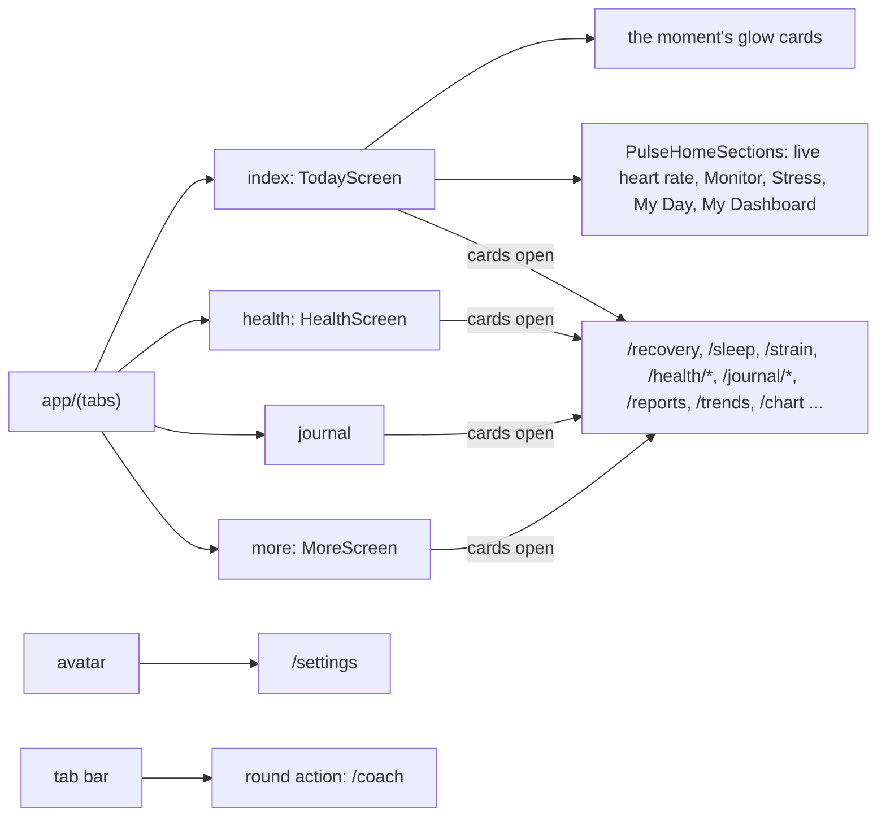

# The glow design (ported from unstrap)

The tab roots and the type of this fork follow the design system of [unstrap](https://github.com/sayed0am/unstrap)
(formerly OpenStrap), the Helio Strap app: its `docs/design/v2/spec.md` is the reference, cited here by section. The
port is a reimplementation in React Native and Skia; unstrap's code is Kotlin and Compose, so nothing is copied as is.
unstrap is MIT or Apache-2.0 (its MIT licence is kept at `src/glow/LICENSE-unstrap-MIT.txt`), its fonts SIL OFL 1.1
(`assets/fonts/OFL-Funnel.txt`).

## What it is

- **Always dark.** OLED black pages, near-black cards, colour only for data (spec 2.2). The old screens follow: the
  dark tokens in `global.css` and `src/ui/palette.ts` are moved onto the same blacks, and the light theme is off.
- **Funnel Display and Funnel Sans** everywhere (spec 2.3), as static faces (docs/learning.md).
- **Dot-matrix numbers** (`src/glow/dotFont.ts`, `DotText`): the 5×7 font and six dot sizes. One dotted number per card.
- **Card tiers** (spec 2.5): the glow card (the hero, L4, and at most one second glow, L3), picture cards with an L2
  rim when off your normal, grouped lists, strips. `src/glow/light.ts` works the light out as plain numbers (fill,
  rim, dark core, tone band, gloss); `GlowCard` paints it with Skia.
- **Moods** (spec 2.1): evening softens the light, night brings it from below; the Sleep tab is always night.
- **Moments** (spec 4.1, `src/glow/moment.ts`): waking up, midday, workout time, during and after a workout, evening,
  night. Today's hero and its cards follow the moment.

## Structure

- Pulse's whole app stays: the four tabs (Home, Health, Journal, More), every page and every number, drawn in the glow
  design. Home opens on the time-of-day hero and then shows everything Pulse's Home did (`PulseHomeSections` in
  `src/screens/home/HomeScreen.tsx`). The Recovery, Sleep and Activity tab pages in `src/glow/tabs/` are no longer routed;
  their parts (the Last night hero) serve the detail pages.
- `src/glow/` is UI only. It reads the existing view models (`src/queries`) and changes nothing in `src/core`,
  `src/pipeline`, `src/health` or `src/data`, so engine fixes from upstream merge cleanly.
- Where the glow rules and Pulse's density meet, Pulse's content wins: a card may carry more than one number, and the
  extra ones are Funnel text, not dots. One dotted number per card and at most one hero glow per screen still hold.

## The mark

The app icon, the splash and the opening draw one heartbeat in the dot font's dots: 13 columns by 9 rows, white, the
cells in `src/glow/mark.ts`. The icon sets it on a glow card in the Energy ink (`#F66C28`), lit from below with a dark
pool behind the mark, the look of Today's hero; the splash and the opening set it on black, and the opening beats it
once with a warm glow behind. `scripts/brand/glow-icon.py` writes every PNG from `mark.ts` (`python3
scripts/brand/glow-icon.py`, needs numpy and Pillow): `icon.png`, the adaptive icon's background, foreground and
monochrome layers (the mark sized for the 2/3 a launcher shows), `icon-tinted.png`, `splash-icon.png` and the favicon.
The old two-bar mark stays only where it is drawn small in the app (`src/ui/brand.tsx`) and in onboarding.

## Not done yet

- Detail pages in the glow tiers (spec 6), the info sheets, Edit Today.
- Home screen widgets in the new look.
- Hourly step bars (no hourly steps in the view models yet), Load by the hour, the moving border on Start a workout.
- Copy in languages other than English: the `glow` namespace is English only and falls back to it.
